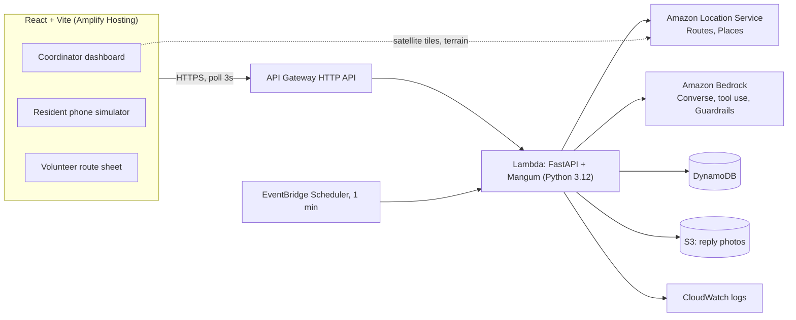

# StillHere: Build Plan for SpartHill Hacks 2026 (AWS Track)

> *In a crisis, silence is the loudest signal.*
>
> Challenge reference: [Problem Statement doc](https://claude.ai/artifact/Rv3os67MtJTq94ratxuw1u). Re-read it before any scope decision. Every requirement from the challenge, rubric and judge instructions is mapped to this plan in [§1.1 Requirements compliance](#11-requirements-compliance-checklist).

**TL;DR:** StillHere is a 3D emergency response command center for people whose lives depend on electricity during a California power shutoff. The coordinator watches the outage unfold on a satellite 3D map with an incident timeline, while Amazon Bedrock does the work at every step:
- writes a personal check-in to every affected resident, in their language
- reads their messy replies (text or photo)
- explains each priority
- escalates people who go silent
- runs a tool-using agent that plans volunteer routes with Amazon Location route optimization

The county coordinator approves every plan. Team of 4, Python + React, about 18 build hours. The deliverable is a 5-minute video.

**Pitch:** *"When the grid goes dark, StillHere shows who is at risk of being left behind. Our 3D emergency command center combines AI-powered outreach, real-time response tracking and human-approved dispatch, so that silence never means someone is forgotten."*

**Visual inspiration:** [FireTrace](https://firemap-two.vercel.app/) (satellite 3D terrain, playback timeline, side panels). FireTrace shows how a wildfire spreads; StillHere shows how an outage turns into escalating risk for vulnerable residents, and how the response catches up.

---

## Contents

1. [What the challenge really asks](#1-what-the-challenge-really-asks) (incl. [requirements compliance checklist](#11-requirements-compliance-checklist))
2. [The solution](#2-the-solution-stillhere)
3. [The demo scenario](#3-the-demo-scenario-golden-path)
4. [Where Bedrock does real work](#4-where-bedrock-does-real-work)
5. [Triage scoring and escalation](#5-triage-scoring-and-escalation)
6. [Architecture](#6-architecture)
7. [Data model](#7-data-model-dynamodb-on-demand)
8. [API contract](#8-api-contract)
9. [Frontend screens](#9-frontend-screens)
10. [Repo layout](#10-repo-layout)
11. [Scope tiers](#11-scope-tiers)
12. [Team roles](#12-team-roles)
13. [Timeline](#13-timeline-18-build-hours)
14. [The 5-minute video](#14-the-5-minute-video)
15. [Rubric scorecard](#15-rubric-scorecard)
16. [Risks and mitigations](#16-risks-and-mitigations)
17. [Verification and test plan](#17-verification-and-test-plan)
18. [Pre-event checklist and open questions](#18-pre-event-checklist-and-open-questions)

---

## 1. What the challenge really asks

| Fact from the rubric | What it means for us |
|---|---|
| Judged **only by video**, with no live Q&A | Anything not shown on screen does not exist. The demo is the product. |
| **Working app: 25 pts**, and the first tie-break | One flawless end-to-end path beats many half-working features. |
| **Bedrock: a pass/fail gate plus 20 pts** | Bedrock must visibly do the core thinking. A single bolted-on chatbot scores "Partial". |
| **Persona and need: 20 pts**, and the second tie-break | A named, specific person with a sourced "so what". |
| **Understanding: 15 pts** | A clear architecture diagram, and the team can explain why each part exists. |
| **Polish: 10 pts** | It should look like something a county official would trust. |
| **Above and beyond: 10 pts** | Real-world ambition: multilingual, safety, real data, extra channels. |
| About 18 build hours; video due **10:30 AM Saturday** | Cut scope hard, freeze code early, and record a safety video. |
| **Two judges, averaged, rotating pairs**; they score only what the video shows and says | The video must be self-explanatory to a stranger: captions, narration names every AWS service, nothing relies on prior context. |
| Item 2 (works) and item 3 (Bedrock) are scored **separately** | A working app with a token Bedrock call loses item 3; a rich Bedrock integration that doesn't run loses item 2. We need both in the same continuous take. |

The toolkit mentions Kiro, but the rubric does not score it. We will build with our usual tools.

### 1.1 Requirements compliance checklist

Every line below must be ticked before submitting. "Where in the video" is what the judges will actually see; if it is not on screen, it does not count.

| # | Requirement (from the challenge, rubric and judge instructions) | How StillHere meets it | Plan section | Where in the video |
|---|---|---|---|---|
| R1 | **Gate:** the app uses an AWS AI service (Amazon Bedrock) doing real work | Five Bedrock jobs plus Guardrails; the app cannot triage, message or plan without them | §4 | Said by name in the first 35 s; live in the demo; Trace drawer at 3:30 |
| R2 | Name a **specific persona** who depends on a critical service | Dana Nguyen, Medical Needs Coordinator, plus the electricity-dependent residents she is accountable for | §2 | 0:00–0:35 |
| R3 | A **real continuity problem** during a crisis (supply shock, disaster, outage) | PG&E Public Safety Power Shutoff cuts power that medical devices and medicine depend on; the phone tree misses the people who don't answer | §2, §18 sources | 0:00–0:35, with cited stats on screen |
| R4 | The "so what" is clear and **drove the build** | "Silence is a signal" drives the escalation ladder, the timeline and the door-knock stops | §2, §5 | 0:20–0:35 and the Lupe moment in the demo |
| R5 | An **AI application**, not just an app written with AI | Bedrock writes, reads, explains, escalates and plans at runtime; every call is traced | §4 | Demo plus Trace drawer |
| R6 | Built **on AWS**, in the provided AWS account | Bedrock, Location, Lambda, API Gateway, DynamoDB, S3, EventBridge, Amplify, SAM | §6 | Architecture segment |
| R7 | A **working** application that solves the need **end to end**, shipped not started | One continuous take on the deployed Amplify URL: zone → check-ins → replies → escalation → plan → approve → volunteer marks done | §3, §11 MUST | 1:00–3:30 |
| R8 | Bedrock is **integral, not bolted on**, and shown working | "Amazon Bedrock" badge on every AI action in the UI; tool calls stream live; Guardrail block shown | §4, §9 | Demo plus 3:30–4:10 |
| R9 | The team **understands what it built** | Diagram with a reason for each service; stated principle "AI reads and explains, rules rank, humans decide"; why scoring is deterministic | §5, §6 | 0:35–1:00 and the deep dive |
| R10 | **Polish:** looks like something a real person would trust | 3D satellite command center, calm panels, approval step, audit trail, "AI-estimated" labels, Demo data labels | §9 | Whole demo |
| R11 | **Above and beyond:** ambition or real-world impact | Silence detection, 3 languages, photo replies, Guardrails, privacy-safe SMS, sourced data, production path (real SMS, Connect voice, county registries) | §11 SHOULD | 4:10–4:30 |
| R12 | Video is **5 minutes or less** | Scripted to 4:45, leaving a 15 s buffer | §14 | Whole video |
| R13 | Video shows the **architecture** | Diagram segment | §6, §14 | 0:35–1:00 |
| R14 | Video **describes the application, persona and need** | Hook and persona segment, plus narration over the demo | §14 | 0:00–0:35 |
| R15 | Video shows **Bedrock in use** (AWS AI services actually working) | Live demo plus Trace drawer close-ups of real calls | §14 | 1:00–4:10 |
| R16 | Submitted by **10:30 AM Saturday** | Internal deadline 9:30 AM; safety video exists from H8 | §13 | n/a |
| R17 | A **way for judges to reach the team** through the event channel | Names and event-channel handle on the end card; contact posted in the channel at submission | §13, §14 | 4:35–4:45 end card |
| R18 | No live Q&A, so **nothing can depend on explaining later** | Captions, on-screen labels, "⏩ sped up" marks, cold-judge test with the official score sheet | §14, §17 | Whole video |

---

## 2. The solution: StillHere

### Persona

**Dana Nguyen, Medical Needs Coordinator, Santa Clara County Public Health.**

PG&E declares a Public Safety Power Shutoff (PSPS): power goes off at 6 PM across the wildfire-risk foothills of East San Jose. The county keeps a registry of residents with access and functional needs inside that zone. Their lives run on electricity:
- insulin that has to stay cool
- home oxygen concentrators
- home dialysis
- power wheelchairs

Today Dana has a spreadsheet, a phone tree and a handful of staff. Calling everyone takes most of a day. **The people who don't pick up are the ones who get missed, and they are usually the ones in the most trouble.**

### The loop

1. **Detect.** Dana draws or loads the outage zone. StillHere finds every registered resident inside it.
2. **Reach.** Bedrock writes each person a short check-in in their language. SMS is not private, so the message never names a diagnosis or a specific device; those details stay in the coordinator's dashboard. Example: *"Hi Rosa, this is Santa Clara County. Power in your area goes off at 6 PM until about 8 AM. How many hours can your medical equipment or medicine last without power? Reply 1 if you're OK, 2 if you need help."*
3. **Understand.** Replies are messy: typos, Vietnamese, Spanish, a photo of an oxygen gauge. Bedrock turns each one into structured needs: supply hours left, transport needed, distress level.
4. **Triage.** A transparent rule-based score ranks every case. Bedrock writes the one-line "why" Dana reads.
5. **Silence is a signal.** No reply triggers a risk-weighted escalation ladder: re-ping, then the emergency contact, then a door-knock.
6. **Act.** A Bedrock tool-use agent plans volunteer runs (cooler, battery pack, door-knock, ride to a resource center), using Amazon Location to optimize stop order and draw real routes. Dana approves with one click. Each volunteer gets a mobile route sheet.
7. **Watch it unfold.** Every step lands on the 3D map and the incident timeline: the zone lights up, markers change color as replies arrive, silent residents pulse red as time passes, and routes draw once Dana approves.

### Why this wins

- **Proactive, not reactive.** Most teams will build "a chatbot you ask for help". StillHere reaches people before they have to ask.
- **Silence as data.** A memorable insight that judges will repeat, and the timeline lets them watch it happen.
- **The visualization is the product.** The 3D map is not decoration: it answers who needs help, where they are, and how fast a volunteer can reach them.
- **One tight loop** that covers communication, triage and routing, instead of three thin features.
- **Trustworthy AI design:** *AI reads and explains, rules rank, humans decide.*
- **Local and real:** Santa Clara County, PG&E PSPS events, and San Jose's large Vietnamese- and Spanish-speaking communities.

---

## 3. The demo scenario (golden path)

All data is synthetic, using 555 phone numbers. There are about 40 residents in the zone. Five of them carry the story:

| Resident | Profile | What happens | What it shows |
|---|---|---|---|
| **Trần Văn Minh**, 78 | Vietnamese, home oxygen, lives alone | Replies in Vietnamese with a **photo of his tank gauge** (about 3 h left; the outage lasts 14 h) | Multimodal plus multilingual extraction; jumps to the top of the queue |
| **Rosa Delgado**, 64 | Spanish, insulin | "tengo 3 plumas, el refri ya no enfría" (3 insulin pens, the fridge has stopped cooling) | Need extracted: cooler and ice delivery |
| **Harold Kim**, 82 | English, power wheelchair | "chair at 20% cant get out if it dies" | Transport to a resource center |
| **Denise Okafor**, 55 | English, home dialysis | "Generator running, all good, thanks" | AI also **de-prioritizes**: case marked OK |
| **Lupe Ramírez**, 89 | Spanish, oxygen, lives alone | **Never replies** | Silence escalation: re-ping → daughter contacted → door-knock stop. This is the hero moment. |

Resources on the map are fictional for the demo: 2 PG&E-style Community Resource Centers and 1 pharmacy. Volunteers: 3, each with a vehicle type.

---

## 4. Where Bedrock does real work

Every Bedrock call writes a row to `traces` and appears in the **AI Trace drawer**. The drawer shows the prompt (PII-masked), tool calls, structured output, latency, tokens and any guardrail action. This is what proves "integral, not bolted on" in the video.

Model IDs come from env vars `BEDROCK_FAST_MODEL_ID` and `BEDROCK_STRONG_MODEL_ID`. Use the cross-region inference profile IDs that the account has access to, and confirm them in the Bedrock console in hour 0. All calls go through the **Converse API**.

### Job 1: Check-in writer (fast model)

- **Input:** resident profile (first name, language, devices, baseline backup hours), outage start and estimated restore time.
- **Output:** an SMS of 300 characters or less, in the resident's language, at a plain reading level. It asks two questions: how many hours their medical equipment or medicine can last without power, and whether they need help (reply 1 or 2).
- **Rules:** no medical advice, never invent facts, **never name a diagnosis or a specific device** (the device is used only to choose the wording, e.g. "equipment" vs "medicine"), and include "Reply STOP to opt out".
- **Speed:** runs in parallel across all affected residents (thread pool of about 10).

### Job 2: Reply understanding (strong model, multimodal)

- **Input:** the resident profile, the last outbound message, and the reply text plus an optional image.
- **Forced tool call** `record_assessment`, with these fields:

```json
{
  "status": "ok | needs_help | unclear",
  "needs": ["cooling_for_medication", "power_for_device", "transport", "medication_resupply", "welfare_check", "other"],
  "supply_hours_left": "number | null",
  "needs_transport": "boolean",
  "distress_level": "0-3",
  "detected_language": "string",
  "english_translation": "string",
  "key_quote": "string (verbatim, original language)",
  "confidence": "0-1",
  "reasoning": "string (1-2 sentences)"
}
```

- If `confidence` is below 0.6, the case is flagged **Needs human review** and a person decides.

### Job 3: Triage explainer (fast model)

- **Input:** the score breakdown from section 5 plus the assessment.
- **Output:** one sentence for Dana. Example: *"Oxygen tank has ~3 h left but power is out for 14 h, he lives alone, and he wrote that he feels short of breath."*

### Job 4: Escalation drafter (fast model)

- **Level 1:** a simpler re-ping in the resident's language.
- **Level 2:** a message to the emergency contact, in the contact's language.
- **Level 3:** a door-knock note for the volunteer (what to check and what to bring).

### Job 5: Dispatch planner agent (strong model, Converse tool-use loop, max 12 turns)

| Tool | What it does |
|---|---|
| `list_open_cases()` | Cases with status `needs_help`, `escalated` or `silent`, with priority, location and needs |
| `list_volunteers()` | Name, vehicle, start location, capacity |
| `find_nearest_resource(lat, lng, type)` | Nearest resource center or pharmacy |
| `optimize_run(start, stops[])` | Amazon Location `OptimizeWaypoints` for stop order, then `CalculateRoutes` for duration, distance and geometry |
| `submit_plan(runs[])` | Final plan. Each run lists volunteer, stops (`resident_id`, action, items, reason) and order |

- **Division of labor:** the agent decides **who goes where and why** (which volunteer, which cases, what to bring, Critical cases first). Amazon Location decides **the fastest order and the road route** within each run. The agent explains the result.
- **System prompt:** cover every case with priority 60 or higher. Put every Critical case in a run before any High case. Never give a volunteer more than 6 stops. Explain each stop in one line.
- **Output:** a **draft** plan. Nothing is dispatched until Dana clicks **Approve**.
- **Why keep an agent instead of only calling the optimizer:** its tool calls stream into the AI Trace drawer, which is the strongest on-screen proof that Bedrock does real work.

### Job 6: Bedrock Guardrails

- A **denied topic** for medication dosing and medical-treatment advice, applied to all resident-facing messages through `guardrailConfig` in Converse.
- **Sensitive information filters** that mask names, phone numbers and addresses before trace text is stored (`ApplyGuardrail`).
- In the video, show one blocked attempt: a resident asks "how much extra insulin should I take?" and gets a safe, approved response.

### Stretch: Knowledge Base

A Bedrock Knowledge Base over public FDA and CDC power-outage guidance, so replies to residents can carry grounded tips (for example, how long insulin can stay at room temperature).

---

## 5. Triage scoring and escalation

**The score is deterministic and explainable (0 to about 130).** The LLM extracts the inputs; the code computes the score.

```
device_weight        oxygen 40 | dialysis 35 | insulin 25 | power_wheelchair 15 | other 10   (max of devices)
time_pressure        +30 if supply_hours_left < outage_hours_remaining
alone                +10 if lives_alone
silence              +5 per 30 virtual minutes without a reply (cap 25)
distress             distress_level × 5
transport            +5 if needs_transport
status_ok            × 0.2 if assessment.status == "ok" and confidence ≥ 0.8
```

Priority bands:
- **Critical** at 80 or above
- **High** from 60 to 79
- **Watch** from 30 to 59
- **OK** below 30

**Escalation ladder.** Timers are risk-weighted and run on virtual time: oxygen and dialysis use half the timers.

| Level | No reply after | Action |
|---|---|---|
| L0 | n/a | Check-in sent |
| L1 | 30 min | Bedrock re-ping, simpler wording |
| L2 | 60 min | Bedrock message to the emergency contact; case becomes `escalated` |
| L3 | 90 min | Case becomes `silent`; automatically added as a **door-knock** stop in the next plan; pin pulses red on the map |

**Incident timeline (the crisis clock).** The app keeps a virtual "now" equal to real time plus an offset. The timeline bar at the bottom of the dashboard is the control for it:
- **Play** at 1×, 4× or 16× speed, plus jump buttons for +30 min, +1 h and +3 h. Each one calls `/clock/advance`, which runs the escalation check immediately. This lets the video show 3 hours of silence in 5 seconds.
- **Event markers** sit on the track (outage start, check-ins sent, each reply, each escalation, plan approved, stop done), and a **Key events** list sits beside it, like FireTrace's.
- **Live counters** above the track: Safe, Needs help, Critical, No reply.
- **Backup countdowns:** each resident's estimated backup hours tick down with virtual time, so a case can move into Critical just because time passed.
- Time only moves forward in the MUST tier. Dragging back to replay earlier states (rebuilt from the `events` log) is a STRETCH item.

An EventBridge schedule also runs the escalation check every minute in real time.

---

## 6. Architecture



| Service | Why it's there |
|---|---|
| **Amazon Bedrock** (Converse, tool use, Guardrails) | All the reasoning: writing, reading, explaining, planning, safety |
| **Amazon Location Service** (Maps, Routes, Places APIs with an API key) | Satellite map style and 3D terrain/buildings in MapLibre; `OptimizeWaypoints` and `CalculateRoutes` for volunteer runs |
| **AWS Lambda + API Gateway** | One FastAPI app: simple to build, test and deploy |
| **DynamoDB** (on-demand) | Serverless state, with no schema migrations mid-hackathon |
| **S3** | Reply photos |
| **EventBridge Scheduler** | Real-time silence escalation |
| **Amplify Hosting** | Frontend deployed from `main` on every push |
| **AWS SAM** | One `template.yaml`; `sam build && sam deploy` |

**3D map.** MapLibre GL JS with Amazon Location's satellite (or hybrid, for street labels) style, draped over 3D terrain with 3D building extrusions, as in the [AWS 3D map tutorial](https://docs.aws.amazon.com/location/latest/developerguide/how-to-create-a-3d-map.html). **Confirm in hour 0** that the account's Amazon Location supports the satellite style and 3D terrain in our region. Fallbacks, in order: open terrain tiles in MapLibre over the Amazon satellite style; then Mapbox GL JS with Mapbox Satellite (free tier). Every map layer we draw is plain GeoJSON, so switching the base map does not touch the rest of the app.

**SMS channel.** Real US SMS needs a registered origination number (toll-free or 10DLC), and approval takes days to weeks. The phone simulator calls **the same `/inbound` webhook** that AWS End User Messaging would call. Say this plainly in the video. Real SMS and an Amazon Connect voice line are the production path; copper landlines often still work during outages.

---

## 7. Data model (DynamoDB, on-demand)

| Table | Keys | Main attributes |
|---|---|---|
| `residents` | PK `resident_id` | name, age, phone, address, lat, lng, language (`en`/`es`/`vi`), devices[], baseline_backup_hours, lives_alone, emergency_contact {name, relation, phone, language}, notes |
| `outages` | PK `outage_id` | name, polygon (GeoJSON), starts_at, est_restore_at, affected_ids[], status |
| `cases` | PK `outage_id`, SK `resident_id` | status (`not_contacted` / `awaiting_reply` / `ok` / `needs_help` / `escalated` / `silent` / `dispatched` / `resolved`), priority, band, score_breakdown, rationale, assessment, escalation_level, last_outbound_at, last_inbound_at, needs_review |
| `messages` | PK `resident_id`, SK `ts` | direction (`out` / `in`), channel (`sms` / `contact` / `door`), text, translation_en, image_key, trace_id |
| `plans` | PK `plan_id` | outage_id, status (`draft` / `approved`), runs[{run_id, volunteer, vehicle, stops[{resident_id, action, items[], reason, eta}], geometry, duration_min}], summary, trace_id |
| `traces` | PK `trace_id` | ts, job, model_id, input_masked, tool_calls[], output, latency_ms, input_tokens, output_tokens, guardrail_action |
| `events` | PK `outage_id`, SK `ts` | type (`outage_started` / `checkins_sent` / `reply` / `escalation` / `band_change` / `plan_drafted` / `plan_approved` / `stop_done`), resident_id?, label, from_status?, to_status?. Feeds the timeline markers and Key events list; also the source for STRETCH replay |
| `config` | PK `key` | `clock_offset_min`, `volunteers`, `resources` |

---

## 8. API contract

Base URL: `${VITE_API_URL}`. All responses are JSON.

| Method and path | Body | Returns |
|---|---|---|
| `POST /demo/reset` | n/a | Reseeds from `data/`, clears cases, messages, plans and traces, sets the clock offset to 0 |
| `POST /outages` | `{name, polygon, starts_at, est_restore_at}` | `{outage_id, affected: [resident_id...]}` (point-in-polygon) |
| `POST /outages/{id}/checkins` | n/a | `{sent: n}` (Job 1 in parallel; cases move to `awaiting_reply`) |
| `POST /inbound` | `{phone, text, image_b64?}` | `{case}` (Jobs 2 and 3, rescored) |
| `POST /clock/advance` | `{minutes}` | `{now, escalations: [...]}` (Job 4) |
| `POST /plans` | `{outage_id}` | `{plan}` (draft, from Job 5) |
| `POST /plans/{id}/approve` | n/a | `{plan}` (cases become `dispatched`) |
| `POST /runs/{run_id}/stops/{resident_id}/done` | n/a | `{case}` (becomes `resolved`) |
| `GET /dashboard?outage_id=` | n/a | `{now, outage, counts: {safe, needs_help, critical, no_reply}, cases[], events[], plan?, resources[], volunteers[]}` (each case carries `backup_hours_left` at virtual now) |
| `GET /residents/{id}/messages` | n/a | `{messages[]}` |
| `GET /traces?limit=50` | n/a | `{traces[]}` |
| `GET /runs/{run_id}` | n/a | `{run}` (volunteer view) |

---

## 9. Frontend screens

Stack: React, Vite, TypeScript, Tailwind, MapLibre GL, and TanStack Query polling every 3 s.

**Make Bedrock visible everywhere (rubric gate and item 3).** Every AI-produced element carries a small "Amazon Bedrock" badge: check-in texts, translations, the "why" on each card, escalation messages and each plan reason. Loading states name the work, for example "Amazon Bedrock is reading Minh's reply…". A judge watching without sound should still see that Bedrock does the work.

1. **Command center (`/`)**, laid out in four areas like FireTrace:
   - **Top bar:** StillHere logo, incident name ("East San Jose PSPS"), area, outage window, Reset demo button, About.
   - **Center: 3D incident map** (the largest area).
     - Satellite base map with 3D terrain and buildings, the camera tilted toward the East San Jose foothills.
     - The outage zone as a translucent red overlay with a dashed edge.
     - One marker per resident, colored by status: green Safe, amber Needs help, red Critical, gray-violet No reply. No-reply markers pulse, and the pulse grows with silence.
     - Volunteers, resource centers and the pharmacy as distinct icons; approved routes drawn per volunteer.
     - Map controls: 2D/3D toggle, terrain exaggeration (1×/2×/3×), satellite/hybrid switch, fullscreen.
     - Clicking a marker **flies the camera** to the home and opens that resident on the right.
   - **Left: incident overview.** Counters (affected, Critical, no reply, pending visits) above a searchable, sortable **triage queue**. One card per case: name, device icons, language badge, status chip, score and band, the AI "why", and a "Needs review" flag. Clicking a card does the same fly-to as the map.
   - **Right: tabbed panel.**
     - **Resident tab:** name and age, medical dependency, last contact, estimated backup left, current response, the AI assessment, the message thread (original plus translation) and the suggested action. Always labeled as AI-estimated urgency, never as a confirmed medical emergency.
     - **AI Trace tab:** a live list of Bedrock calls. Clicking one shows the prompt, tool calls step by step, JSON output, latency, tokens and guardrail action.
     - **Plan tab:** the draft dispatch plan, per volunteer, with the agent's one-line reasons and the **Approve** button.
   - **Bottom: incident timeline** (§5). Play/pause, speed, jump buttons, event markers on the track, live counters, and a Key events list beside it.
   - **Action bar** (above the timeline): Send check-ins → Plan dispatch → Approve plan.
2. **Resident phone simulator (`/phone`).** A phone-shaped frame with a resident picker, an SMS thread, a text box, and a photo attach. A list of **quick replies** (from `data/test_replies.json`) makes recording reliable.
3. **Volunteer route sheet (`/run/:runId`).** Mobile layout: a flat 2D map (fast on phones), ordered stops with action, items, address and reason, and a "Mark done" button.
4. **About panel.** Dana's story and sourced real-world stats with links.

**Design.** Satellite map in the center; everything around it is calm and light, like FireTrace: warm off-white (cream) panels, dark gray text, thin dividers, one accent color, and red reserved for Critical. Large type and clear status chips. Markers and routes get a white outline so they stay readable on busy satellite imagery. All demo residents are fictional and labeled "Demo data".

---

## 10. Repo layout

```
Spartan-hack/
├── README.md                 ← folder map, ownership, how to run
├── .env.example              ← every env var, one line each
├── amplify.yml               ← Amplify Hosting build for frontend/
├── docs/
│   ├── PLAN.md               ← this file
│   ├── PROGRESS.md           ← phase status, scope tracker, decisions, open questions
│   ├── architecture.png
│   ├── video_script.md
│   ├── submission.md         ← video link, team contacts, R1–R18 tick list from §1.1
│   └── sources.md            ← cited stats for the persona
├── data/
│   ├── residents.json        ← ~40 synthetic residents (5 hero residents from §3)
│   ├── outage_zone.geojson
│   ├── resources.json        ← resource centers, pharmacy
│   ├── volunteers.json
│   └── test_replies.json     ← 20 labeled replies (eval + quick replies)
├── backend/
│   ├── app/
│   │   ├── main.py           ← FastAPI routes + Mangum handler
│   │   ├── schemas.py        ← shared contract: Pydantic models for §7 and §8
│   │   ├── bedrock.py        ← converse() wrapper, tracing, guardrails, Jobs 1–4
│   │   ├── prompts/          ← checkin.md, assess.md, explain.md, escalate.md, planner.md
│   │   ├── tools.py          ← tool schemas + implementations for the agent
│   │   ├── agent.py          ← tool-use loop
│   │   ├── triage.py         ← deterministic score + bands
│   │   ├── escalation.py     ← ladder + virtual clock
│   │   ├── geo.py            ← point-in-polygon (ray casting), nearest resource
│   │   ├── location.py       ← Amazon Location routes client
│   │   └── store.py          ← DynamoDB access
│   ├── data -> ../data       ← symlink: `sam build` ships the seed data
│   ├── tests/
│   │   ├── conftest.py       ← in-memory DynamoDB stand-in
│   │   ├── test_triage.py
│   │   ├── test_geo.py
│   │   ├── test_store.py
│   │   ├── test_seed_data.py
│   │   └── eval_replies.py   ← runs Job 2 against test_replies.json
│   ├── pytest.ini
│   ├── requirements.txt
│   └── requirements-dev.txt  ← pytest, httpx, uvicorn (not in the Lambda)
├── frontend/
│   └── src/
│       ├── pages/            ← CommandCenter, Phone, RunSheet
│       ├── components/
│       │   ├── status.ts     ← status colors and labels; BedrockBadge.tsx
│       │   ├── map/          ← IncidentMap (3D), layers/: zone, residents, routes, resources
│       │   ├── timeline/     ← Timeline, KeyEvents, Counters
│       │   └── panels/       ← Overview, TriageQueue, ResidentPanel, TraceDrawer, PlanPanel
│       └── api/
│           ├── types.ts      ← shared contract: TypeScript mirror of schemas.py
│           ├── client.ts     ← fetch helpers + useDashboard()
│           └── seed.ts       ← data/*.json, typed
└── infra/
    └── template.yaml         ← SAM: Lambda, HTTP API, tables, bucket, schedule, IAM
```

---

## 11. Scope tiers

Cut from the bottom up.

### MUST: the golden path, green by H8

- [ ] Seed data, plus a Reset demo button
- [ ] Outage zone → affected residents on a **flat (2D) satellite map**, markers colored by status
- [ ] Job 1: check-ins sent (shown in the phone simulator)
- [ ] Job 2: text replies → assessment → Job 3: score and "why" in the queue
- [ ] Timeline bar (forward only: play and jump buttons, counters, event markers) plus escalation L1 to L3 (Job 4)
- [ ] Job 5: agent plan → routes on the map → Approve → volunteer view
- [ ] AI Trace drawer
- [ ] Deployed: Amplify URL plus the SAM stack

If the golden path works on the flat map, the demo is safe. 3D is an upgrade on top, not a dependency.

### SHOULD: H8 to H12

- [ ] **3D terrain and buildings**, tilted camera, 2D/3D toggle
- [ ] Click a marker or card → camera flies to the home → Resident panel opens
- [ ] Backup-hours countdown per resident, pulsing no-reply markers, Key events list
- [ ] Photo replies (multimodal)
- [ ] Spanish and Vietnamese end to end
- [ ] Guardrails (denied topic plus PII masking in traces)
- [ ] "Needs human review" path for low confidence
- [ ] Design polish, plus loading, empty and error states
- [ ] About panel with sourced stats

### STRETCH: only if the golden path is green at H12

- [ ] Drag the timeline back to replay earlier states (rebuilt from `events`)
- [ ] Small charts under the timeline (cases by band over time, replies over time), like FireTrace's
- [ ] Animated route drawing and a moving volunteer dot after approval
- [ ] Knowledge Base grounded tips
- [ ] One-click SITREP for the county Emergency Operations Center (EOC)
- [ ] Natural-language questions for the coordinator ("who on Story Rd hasn't replied?")
- [ ] Amazon Connect voice line

---

## 12. Team roles

| Role | Owns | Hands off |
|---|---|---|
| **P1, Frontend and UX** | Command center layout, 3D map, timeline, phone simulator, volunteer view, polish | Screens wired to the API contract in §8 |
| **P2, Backend and infra** | SAM, FastAPI routes, DynamoDB, Location routes and waypoint optimization, reset, clock, events log, escalation job, deploys | Live API URL by H1, all endpoints by H6 |
| **P3, AI** | Prompts, tool schemas, the `bedrock.py` wrapper and tracing, agent loop, Guardrails, eval | Jobs 1–5 callable from routes; eval at 18/20 or better |
| **P4, Story, data and video** | Persona research and sources, synthetic data, test replies, architecture diagram, video script, recording and edit, QA, submission | Data files by H2; safety video at H8; final video by H17 |

**Rule:** P2 owns `main` merges. Commit small and often. `main` must always deploy.

---

## 13. Timeline (18 build hours)

H0 is when hacking starts.

| Hours | P1 Frontend | P2 Backend | P3 AI | P4 Story and data | Gate |
|---|---|---|---|---|---|
| **H0–H1** | Vite app, Tailwind, MapLibre with the Location satellite style; **test 3D terrain on a throwaway page** | SAM skeleton, hello route deployed | **Request Bedrock model access first**; hello `converse()` | Repo docs, start `residents.json` | **Deployed URL returns a Bedrock reply; 3D path chosen (Amazon or fallback)** |
| H1–H4 | Four-area layout, flat map, timeline bar, simulator on mock JSON | Tables (incl. `events`), `/demo/reset`, `/outages`, point-in-polygon | Jobs 1 and 2 with tool schema; trace logging | Residents, zone, resources, volunteers, 20 test replies | Each part works alone |
| H4–H6 | Wire to the live API, polling; counters and markers from `/dashboard` | `/inbound`, `/clock/advance`, triage, escalation, event writes | Jobs 3 and 4; eval run | Persona sources; script draft | Replies flow into the queue and onto the map |
| H6–H7 | Routes on the map, Plan tab, volunteer view | `OptimizeWaypoints` + `CalculateRoutes`, `/plans` | Job 5 agent loop | Architecture diagram v1 | Plan renders |
| **H7–H8** | **All: run the golden path end to end on the deployed URL** | | | **Record the safety video** | **Golden path green, or cut** |
| H8–H12 | **3D terrain and buildings**, fly-to, pulsing markers, Key events, AI Trace detail, states | Photo upload to S3, backup countdowns, hardening | Photo input, ES/VI, Guardrails, review flag | About panel content, rehearse narration; check 3D readability on video | SHOULD tier done |
| H12–H14 | Stretch UI or polish | Stretch or hardening | Stretch (KB or SITREP) | Shot list, final script | Green or harden |
| **H14–H15** | **Code freeze.** All: 3 clean runs from reset; fix blockers only | | | | 3 clean runs in a row |
| H15–H17 | Screen recording support | Standby for fixes | Trace drawer close-ups | Record, voiceover, edit, captions | Final cut |
| H17–H18 | All: watch it cold with the official score sheet and tick R1–R18 in §1.1; confirm runtime is 5:00 or less; submit **by 9:30 AM** and post contact info in the event channel | | | | **Submitted** |

---

## 14. The 5-minute video

The challenge asks for three things: **architecture**, **the application with its persona and need**, and **Amazon Bedrock in use**. Each has its own labeled segment below, and an on-screen chapter title ("1 · The problem", "2 · Architecture", "3 · Live demo", "4 · Amazon Bedrock inside", "5 · Impact") so a judge can tick each one off. **Target runtime 4:45**; the hard limit is 5:00.

| Time | Segment | On screen |
|---|---|---|
| 0:00–0:35 | **Hook and persona.** Open on the 3D satellite view of the East San Jose foothills at dusk. "At 6 PM the power goes off. In some of these homes, someone's life runs on electricity." Dana's problem: a phone tree, and the people who don't answer get missed. Close with the one-sentence answer: "StillHere is an AI application on AWS, powered by Amazon Bedrock, that reaches every one of them and notices who goes silent." | 3D map, sourced stats, Dana's spreadsheet compared with StillHere |
| 0:35–1:00 | **Architecture.** Each AWS service and why it's there, Bedrock first. "AI reads and explains, rules rank, humans decide." | Diagram (§6) |
| 1:00–3:30 | **Live demo**, one continuous take on the deployed URL: load the zone → the red overlay appears and 40 markers drop in → send check-ins (3 languages appear in the phone) → Minh replies in Vietnamese with a gauge photo → his marker turns red; click it, the camera flies to his home, the panel shows the "why" → Rosa and Harold reply; Denise turns green → **press play on the timeline**: counters tick, event markers appear, Lupe's marker pulses harder, her daughter is texted, a door-knock is added → **Plan dispatch**: the agent's tool calls stream → routes draw across the terrain → **Approve** → the volunteer's phone route sheet | Command center, phone simulator, volunteer view |
| 3:30–4:10 | **Bedrock deep dive.** Open the AI Trace drawer: Minh's call (image in, JSON out), the agent's tool-call sequence, a Guardrail blocking dosage advice. Show the `converse()` code briefly. Name the five jobs out loud. | Trace drawer, code |
| 4:10–4:35 | **Above and beyond, and impact.** Silence as signal, 3 languages, photos, human approval; path to real SMS, a Connect voice line and county registries | Feature montage |
| 4:35–4:45 | Team names and how judges can reach us (event-channel handle) | End card |

**Recording rules:**
- 1080p, browser zoom at 110%, notifications off.
- Voiceover recorded separately, then synced.
- Captions on.
- Any trimmed wait gets an on-screen "⏩ sped up".
- Say "Amazon Bedrock" out loud at least once in the first minute and again during the demo; the gate is the first thing judges check.
- The demo segment is a real, unedited run on the deployed URL (trims for waiting only). Never mock a step on camera: item 2 is the first tie-break.
- Put the deployed URL on screen during the demo, so it is clearly shipped.

---

## 15. Rubric scorecard

| Item | Target | How we reach Strong | Shown at |
|---|---|---|---|
| **Gate:** AWS AI service | Pass | Bedrock named in the first minute, badged in the UI, proven in the Trace drawer | 0:30, 1:00–4:10 |
| 1. Persona (20) | Strong | Named coordinator, a real PSPS context, cited stats, the Lupe "silent resident" story | 0:00–0:35, Lupe in demo |
| 2. Working (25) | Strong | One continuous end-to-end take on a deployed URL; resettable; 3 clean rehearsals | 1:00–3:30 |
| 3. Bedrock (20) | Strong | 5 distinct jobs, including a multimodal extractor and a tool-use agent, shown in the Trace drawer, plus Guardrails | Demo, 3:30–4:10 |
| 4. Understanding (15) | Strong | Clear diagram, a stated design principle, the reason scoring is deterministic | 0:35–1:00, deep dive |
| 5. Polish (10) | Strong | 3D satellite command center with a playback timeline; calm, consistent panels; an approval step; an audit trail | Whole demo |
| 6. Above and beyond (10) | Strong | Silence detection made visible over time, 3 languages, photos, Guardrails, privacy-safe SMS, sourced real data, channel roadmap | 4:10–4:35 |

Tie-breaks run in the order item 2, item 1, item 3, which matches where we spend the most effort: the golden path first, the persona story second, Bedrock depth third.

---

## 16. Risks and mitigations

| Risk | Mitigation |
|---|---|
| Bedrock model access is slow or denied | Request in the first minutes. A fallback model ID in env (another Claude tier or Amazon Nova) |
| LLM latency drags the demo | Fast model for bulk jobs, parallel check-ins, spinners and streaming. Trims marked "sped up" |
| Wrong or hallucinated triage | Forced tool schema, deterministic score, confidence threshold sends low-confidence cases to human review, approval before dispatch |
| Agent loops or fails | Max 12 turns. Fallback: a greedy planner in code (priority, then nearest neighbor) |
| Amazon Location issues | Fallback to straight-line legs; MapLibre with OSM tiles as a last resort |
| 3D terrain unavailable, slow or hard to read | Flat satellite map is the MUST tier, so 3D can be switched off without breaking anything. Fallbacks in §6. Keep 3D to the command center (not the volunteer phone view), and record on a machine with a decent GPU |
| East San Jose is mostly flat, so 3D looks underwhelming | Tilt the camera toward the foothills, place the outage zone along the hills, turn on 3D buildings and 2× terrain exaggeration |
| `OptimizeWaypoints` unavailable or limited | The agent orders stops itself (urgency, then nearest neighbor) and calls `CalculateRoutes` only |
| Integration problems late in the build | Walking skeleton at H1, API contract fixed in §8, hard gate at H8, code freeze at H14 |
| Video runs out of time | Safety video at H8; final edit starts at H15 |
| Lambda payload limit on photos | Resize client-side to under 1 MB before sending as base64 |

---

## 17. Verification and test plan

- **Unit tests** (`pytest`):
  - `test_triage.py`: score and band for each hero resident
  - `test_geo.py`: points inside, outside and on the edge of the polygon
- **AI eval** (`backend/tests/eval_replies.py`): 20 labeled replies (EN/ES/VI, typos, ambiguous replies, 2 photos). Pass at 18/20 or better on need type and priority band before H8. Rerun after every prompt change.
- **Privacy check:** every Job 1 and Job 4 resident message in the eval run is checked for device or diagnosis words (oxygen, dialysis, insulin, wheelchair, and their ES/VI forms). Any hit fails the run.
- **Golden-path script:** reset → zone → check-ins → 4 replies → timeline +3h → plan → approve → mark one stop done. At each step, the map markers, counters and Key events list must match the case statuses. Pass when it runs on the deployed URL **3 times in a row** with no manual fixes, and each Bedrock step stays under about 6 s (agent under about 20 s).
- **Cold-judge test:** someone outside the team scores the final video with the official score sheet. Fix anything they could not see.

---

## 18. Pre-event checklist and open questions

- [ ] **Rules:** may code be written before hacking starts? If not, prepare only docs, data and design before H0.
- [ ] **Event schedule:** confirm the exact start time so H0 to H18 maps to the clock.
- [ ] **AWS account:** region, and Bedrock model access for one fast and one strong Claude model.
- [ ] **Amazon Location:** confirm the satellite/hybrid map style, 3D terrain and `OptimizeWaypoints` are available in our region with an API key. If 3D terrain is not, get a Mapbox token ready as the fallback.
- [ ] **Persona sources** for `docs/sources.md`:
  - HHS emPOWER: electricity-dependent Medicare beneficiaries in Santa Clara County
  - PG&E PSPS history: number of events and customers affected
  - FDA guidance on insulin storage during outages
  - One documented outage-related harm
- [ ] **Assets:** wireframes of the four-area command center (use FireTrace as the reference), the phone simulator and the volunteer view; a draft of the architecture diagram.
- [ ] **Accounts:** an Amplify app connected to this repo; a screen recorder ready (for example OBS).
- [ ] **Submission:** confirm with organizers where the video is uploaded (form, Devpost, YouTube unlisted?), the accepted format, and the event communication channel for judge questions. Record answers in `docs/submission.md`.
