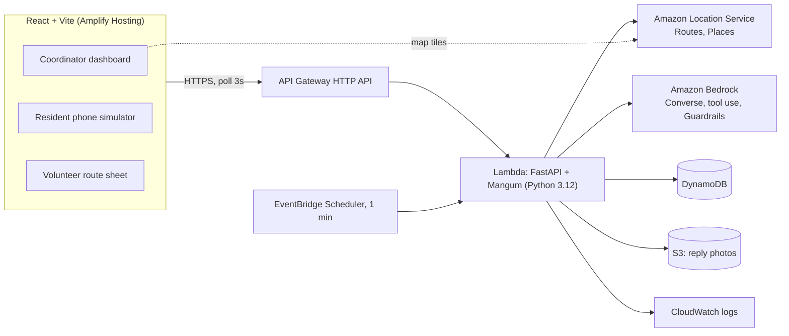

# StillHere: Build Plan for SpartHill Hacks 2026 (AWS Track)

> *In a crisis, silence is the loudest signal.*
>
> Challenge reference: [Problem Statement doc](https://claude.ai/artifact/Rv3os67MtJTq94ratxuw1u). Re-read it before any scope decision.

**TL;DR:** StillHere is an AI check-in, triage and dispatch loop for people whose lives depend on electricity during a California power shutoff. Amazon Bedrock does the work at every step:
- writes a personal check-in to every affected resident, in their language
- reads their messy replies (text or photo)
- explains each priority
- escalates people who go silent
- runs a tool-using agent that plans volunteer routes on Amazon Location

The county coordinator approves every plan. Team of 4, Python + React, about 18 build hours. The deliverable is a 5-minute video.

---

## Contents

1. [What the challenge really asks](#1-what-the-challenge-really-asks)
2. [The solution](#2-the-solution-stillhere)
3. [The demo scenario](#3-the-demo-scenario-golden-path)
4. [Where Bedrock does real work](#4-where-bedrock-does-real-work)
5. [Triage scoring and escalation](#5-triage-scoring-and-escalation)
6. [Architecture](#6-architecture)
7. [Data model](#7-data-model-dynamodb-on-demand)
8. [API contract](#8-api-contract)
9. [Frontend screens](#9-frontend-screens)
10. [Repo layout](#10-repo-layout)
11. [Scope tiers](#11-scope-tiers)
12. [Team roles](#12-team-roles)
13. [Timeline](#13-timeline-18-build-hours)
14. [The 5-minute video](#14-the-5-minute-video)
15. [Rubric scorecard](#15-rubric-scorecard)
16. [Risks and mitigations](#16-risks-and-mitigations)
17. [Verification and test plan](#17-verification-and-test-plan)
18. [Pre-event checklist and open questions](#18-pre-event-checklist-and-open-questions)

---

## 1. What the challenge really asks

| Fact from the rubric | What it means for us |
|---|---|
| Judged **only by video**, with no live Q&A | Anything not shown on screen does not exist. The demo is the product. |
| **Working app: 25 pts**, and the first tie-break | One flawless end-to-end path beats many half-working features. |
| **Bedrock: a pass/fail gate plus 20 pts** | Bedrock must visibly do the core thinking. A single bolted-on chatbot scores "Partial". |
| **Persona and need: 20 pts**, and the second tie-break | A named, specific person with a sourced "so what". |
| **Understanding: 15 pts** | A clear architecture diagram, and the team can explain why each part exists. |
| **Polish: 10 pts** | It should look like something a county official would trust. |
| **Above and beyond: 10 pts** | Real-world ambition: multilingual, safety, real data, extra channels. |
| About 18 build hours; video due **10:30 AM Saturday** | Cut scope hard, freeze code early, and record a safety video. |

The toolkit mentions Kiro, but the rubric does not score it. We will build with our usual tools.

---

## 2. The solution: StillHere

### Persona

**Dana Nguyen, Medical Needs Coordinator, Santa Clara County Public Health.**

PG&E declares a Public Safety Power Shutoff (PSPS): power goes off at 6 PM across the wildfire-risk foothills of East San Jose. The county keeps a registry of residents with access and functional needs inside that zone. Their lives run on electricity:
- insulin that has to stay cool
- home oxygen concentrators
- home dialysis
- power wheelchairs

Today Dana has a spreadsheet, a phone tree and a handful of staff. Calling everyone takes most of a day. **The people who don't pick up are the ones who get missed, and they are usually the ones in the most trouble.**

### The loop

1. **Detect.** Dana draws or loads the outage zone. StillHere finds every registered resident inside it.
2. **Reach.** Bedrock writes each person a short check-in in their language that names their specific device. Example: *"Your oxygen concentrator will lose power at 6 PM. How many hours does your backup tank last? Reply 1 if you're OK, 2 if you need help."*
3. **Understand.** Replies are messy: typos, Vietnamese, Spanish, a photo of an oxygen gauge. Bedrock turns each one into structured needs: supply hours left, transport needed, distress level.
4. **Triage.** A transparent rule-based score ranks every case. Bedrock writes the one-line "why" Dana reads.
5. **Silence is a signal.** No reply triggers a risk-weighted escalation ladder: re-ping, then the emergency contact, then a door-knock.
6. **Act.** A Bedrock tool-use agent plans volunteer runs (cooler, battery pack, door-knock, ride to a resource center) with real routes. Dana approves with one click. Each volunteer gets a mobile route sheet.

### Why this wins

- **Proactive, not reactive.** Most teams will build "a chatbot you ask for help". StillHere reaches people before they have to ask.
- **Silence as data.** A memorable insight that judges will repeat.
- **One tight loop** that covers communication, triage and routing, instead of three thin features.
- **Trustworthy AI design:** *AI reads and explains, rules rank, humans decide.*
- **Local and real:** Santa Clara County, PG&E PSPS events, and San Jose's large Vietnamese- and Spanish-speaking communities.

---

## 3. The demo scenario (golden path)

All data is synthetic, using 555 phone numbers. There are about 40 residents in the zone. Five of them carry the story:

| Resident | Profile | What happens | What it shows |
|---|---|---|---|
| **Trần Văn Minh**, 78 | Vietnamese, home oxygen, lives alone | Replies in Vietnamese with a **photo of his tank gauge** (about 3 h left; the outage lasts 14 h) | Multimodal plus multilingual extraction; jumps to the top of the queue |
| **Rosa Delgado**, 64 | Spanish, insulin | "tengo 3 plumas, el refri ya no enfría" (3 insulin pens, the fridge has stopped cooling) | Need extracted: cooler and ice delivery |
| **Harold Kim**, 82 | English, power wheelchair | "chair at 20% cant get out if it dies" | Transport to a resource center |
| **Denise Okafor**, 55 | English, home dialysis | "Generator running, all good, thanks" | AI also **de-prioritizes**: case marked OK |
| **Lupe Ramírez**, 89 | Spanish, oxygen, lives alone | **Never replies** | Silence escalation: re-ping → daughter contacted → door-knock stop. This is the hero moment. |

Resources on the map are fictional for the demo: 2 PG&E-style Community Resource Centers and 1 pharmacy. Volunteers: 3, each with a vehicle type.

---

## 4. Where Bedrock does real work

Every Bedrock call writes a row to `traces` and appears in the **AI Trace drawer**. The drawer shows the prompt (PII-masked), tool calls, structured output, latency, tokens and any guardrail action. This is what proves "integral, not bolted on" in the video.

Model IDs come from env vars `BEDROCK_FAST_MODEL_ID` and `BEDROCK_STRONG_MODEL_ID`. Use the cross-region inference profile IDs that the account has access to, and confirm them in the Bedrock console in hour 0. All calls go through the **Converse API**.

### Job 1: Check-in writer (fast model)

- **Input:** resident profile (first name, language, devices, baseline backup hours), outage start and estimated restore time.
- **Output:** an SMS of 300 characters or less, in the resident's language, at a plain reading level. It names the device and asks two questions: how many hours of supply/backup they have left, and whether they need help (reply 1 or 2).
- **Rules:** no medical advice, never invent facts, and include "Reply STOP to opt out".
- **Speed:** runs in parallel across all affected residents (thread pool of about 10).

### Job 2: Reply understanding (strong model, multimodal)

- **Input:** the resident profile, the last outbound message, and the reply text plus an optional image.
- **Forced tool call** `record_assessment`, with these fields:

```json
{
  "status": "ok | needs_help | unclear",
  "needs": ["cooling_for_medication", "power_for_device", "transport", "medication_resupply", "welfare_check", "other"],
  "supply_hours_left": "number | null",
  "needs_transport": "boolean",
  "distress_level": "0-3",
  "detected_language": "string",
  "english_translation": "string",
  "key_quote": "string (verbatim, original language)",
  "confidence": "0-1",
  "reasoning": "string (1-2 sentences)"
}
```

- If `confidence` is below 0.6, the case is flagged **Needs human review** and a person decides.

### Job 3: Triage explainer (fast model)

- **Input:** the score breakdown from section 5 plus the assessment.
- **Output:** one sentence for Dana. Example: *"Oxygen tank has ~3 h left but power is out for 14 h, he lives alone, and he wrote that he feels short of breath."*

### Job 4: Escalation drafter (fast model)

- **Level 1:** a simpler re-ping in the resident's language.
- **Level 2:** a message to the emergency contact, in the contact's language.
- **Level 3:** a door-knock note for the volunteer (what to check and what to bring).

### Job 5: Dispatch planner agent (strong model, Converse tool-use loop, max 12 turns)

| Tool | What it does |
|---|---|
| `list_open_cases()` | Cases with status `needs_help`, `escalated` or `silent`, with priority, location and needs |
| `list_volunteers()` | Name, vehicle, start location, capacity |
| `find_nearest_resource(lat, lng, type)` | Nearest resource center or pharmacy |
| `get_route(waypoints[])` | Amazon Location `CalculateRoutes`: duration, distance, geometry |
| `submit_plan(runs[])` | Final plan. Each run lists volunteer, stops (`resident_id`, action, items, reason) and order |

- **System prompt:** cover every case with priority 60 or higher. Order stops by urgency first, then distance. Never give a volunteer more than 6 stops. Explain each stop in one line.
- **Output:** a **draft** plan. Nothing is dispatched until Dana clicks **Approve**.

### Job 6: Bedrock Guardrails

- A **denied topic** for medication dosing and medical-treatment advice, applied to all resident-facing messages through `guardrailConfig` in Converse.
- **Sensitive information filters** that mask names, phone numbers and addresses before trace text is stored (`ApplyGuardrail`).
- In the video, show one blocked attempt: a resident asks "how much extra insulin should I take?" and gets a safe, approved response.

### Stretch: Knowledge Base

A Bedrock Knowledge Base over public FDA and CDC power-outage guidance, so replies to residents can carry grounded tips (for example, how long insulin can stay at room temperature).

---

## 5. Triage scoring and escalation

**The score is deterministic and explainable (0 to about 130).** The LLM extracts the inputs; the code computes the score.

```
device_weight        oxygen 40 | dialysis 35 | insulin 25 | power_wheelchair 15 | other 10   (max of devices)
time_pressure        +30 if supply_hours_left < outage_hours_remaining
alone                +10 if lives_alone
silence              +5 per 30 virtual minutes without a reply (cap 25)
distress             distress_level × 5
transport            +5 if needs_transport
status_ok            × 0.2 if assessment.status == "ok" and confidence ≥ 0.8
```

Priority bands:
- **Critical** at 80 or above
- **High** from 60 to 79
- **Watch** from 30 to 59
- **OK** below 30

**Escalation ladder.** Timers are risk-weighted and run on virtual time: oxygen and dialysis use half the timers.

| Level | No reply after | Action |
|---|---|---|
| L0 | n/a | Check-in sent |
| L1 | 30 min | Bedrock re-ping, simpler wording |
| L2 | 60 min | Bedrock message to the emergency contact; case becomes `escalated` |
| L3 | 90 min | Case becomes `silent`; automatically added as a **door-knock** stop in the next plan; pin pulses red on the map |

**Crisis clock.** The app keeps a virtual "now" equal to real time plus an offset. Buttons for +30 min, +1 h and +3 h call `/clock/advance`, which runs the escalation check immediately. This lets the video show 3 hours of silence in 5 seconds. An EventBridge schedule also runs the check every minute in real time.

---

## 6. Architecture



| Service | Why it's there |
|---|---|
| **Amazon Bedrock** (Converse, tool use, Guardrails) | All the reasoning: writing, reading, explaining, planning, safety |
| **Amazon Location Service** (Maps, Routes, Places APIs with an API key) | Map tiles in MapLibre, real driving routes for volunteers |
| **AWS Lambda + API Gateway** | One FastAPI app: simple to build, test and deploy |
| **DynamoDB** (on-demand) | Serverless state, with no schema migrations mid-hackathon |
| **S3** | Reply photos |
| **EventBridge Scheduler** | Real-time silence escalation |
| **Amplify Hosting** | Frontend deployed from `main` on every push |
| **AWS SAM** | One `template.yaml`; `sam build && sam deploy` |

**SMS channel.** Real US SMS needs a registered origination number (toll-free or 10DLC), and approval takes days to weeks. The phone simulator calls **the same `/inbound` webhook** that AWS End User Messaging would call. Say this plainly in the video. Real SMS and an Amazon Connect voice line are the production path; copper landlines often still work during outages.

---

## 7. Data model (DynamoDB, on-demand)

| Table | Keys | Main attributes |
|---|---|---|
| `residents` | PK `resident_id` | name, age, phone, address, lat, lng, language (`en`/`es`/`vi`), devices[], baseline_backup_hours, lives_alone, emergency_contact {name, relation, phone, language}, notes |
| `outages` | PK `outage_id` | name, polygon (GeoJSON), starts_at, est_restore_at, affected_ids[], status |
| `cases` | PK `outage_id`, SK `resident_id` | status (`not_contacted` / `awaiting_reply` / `ok` / `needs_help` / `escalated` / `silent` / `dispatched` / `resolved`), priority, band, score_breakdown, rationale, assessment, escalation_level, last_outbound_at, last_inbound_at, needs_review |
| `messages` | PK `resident_id`, SK `ts` | direction (`out` / `in`), channel (`sms` / `contact` / `door`), text, translation_en, image_key, trace_id |
| `plans` | PK `plan_id` | outage_id, status (`draft` / `approved`), runs[{run_id, volunteer, vehicle, stops[{resident_id, action, items[], reason, eta}], geometry, duration_min}], summary, trace_id |
| `traces` | PK `trace_id` | ts, job, model_id, input_masked, tool_calls[], output, latency_ms, input_tokens, output_tokens, guardrail_action |
| `config` | PK `key` | `clock_offset_min`, `volunteers`, `resources` |

---

## 8. API contract

Base URL: `${VITE_API_URL}`. All responses are JSON.

| Method and path | Body | Returns |
|---|---|---|
| `POST /demo/reset` | n/a | Reseeds from `data/`, clears cases, messages, plans and traces, sets the clock offset to 0 |
| `POST /outages` | `{name, polygon, starts_at, est_restore_at}` | `{outage_id, affected: [resident_id...]}` (point-in-polygon) |
| `POST /outages/{id}/checkins` | n/a | `{sent: n}` (Job 1 in parallel; cases move to `awaiting_reply`) |
| `POST /inbound` | `{phone, text, image_b64?}` | `{case}` (Jobs 2 and 3, rescored) |
| `POST /clock/advance` | `{minutes}` | `{now, escalations: [...]}` (Job 4) |
| `POST /plans` | `{outage_id}` | `{plan}` (draft, from Job 5) |
| `POST /plans/{id}/approve` | n/a | `{plan}` (cases become `dispatched`) |
| `POST /runs/{run_id}/stops/{resident_id}/done` | n/a | `{case}` (becomes `resolved`) |
| `GET /dashboard?outage_id=` | n/a | `{now, outage, cases[], plan?, resources[], volunteers[]}` |
| `GET /residents/{id}/messages` | n/a | `{messages[]}` |
| `GET /traces?limit=50` | n/a | `{traces[]}` |
| `GET /runs/{run_id}` | n/a | `{run}` (volunteer view) |

---

## 9. Frontend screens

Stack: React, Vite, TypeScript, Tailwind, MapLibre GL, and TanStack Query polling every 3 s.

1. **Coordinator dashboard (`/`)**
   - **Top bar:** outage name, crisis clock (virtual time with +30m, +1h and +3h buttons), Reset demo button, About.
   - **Left: triage queue.** One card per case: name, device icons, language badge, status chip, score and band, the AI "why", the last message (original plus translation), and a "Needs review" flag.
   - **Center: map.** Outage polygon, pins colored by band (silent pins pulse red), resource centers, and approved routes drawn per volunteer.
   - **Action bar:** Send check-ins → Plan dispatch → Approve plan.
   - **Right: AI Trace drawer.** A live list of Bedrock calls. Clicking one shows the prompt, tool calls step by step, JSON output, latency, tokens and guardrail action.
2. **Resident phone simulator (`/phone`).** A phone-shaped frame with a resident picker, an SMS thread, a text box, and a photo attach. A list of **quick replies** (from `data/test_replies.json`) makes recording reliable.
3. **Volunteer route sheet (`/run/:runId`).** Mobile layout: map, ordered stops with action, items, address and reason, and a "Mark done" button.
4. **About panel.** Dana's story and sourced real-world stats with links.

Design: calm public-service look. Neutral background, one accent color, and red reserved for Critical. Large type and clear status chips.

---

## 10. Repo layout

```
Spartan-hack/
├── README.md
├── docs/
│   ├── PLAN.md               ← this file
│   ├── architecture.png
│   ├── video_script.md
│   └── sources.md            ← cited stats for the persona
├── data/
│   ├── residents.json        ← ~40 synthetic residents (5 hero residents from §3)
│   ├── outage_zone.geojson
│   ├── resources.json        ← resource centers, pharmacy
│   ├── volunteers.json
│   └── test_replies.json     ← 20 labeled replies (eval + quick replies)
├── backend/
│   ├── app/
│   │   ├── main.py           ← FastAPI routes + Mangum handler
│   │   ├── bedrock.py        ← converse() wrapper, tracing, guardrails
│   │   ├── prompts/          ← checkin.md, assess.md, explain.md, escalate.md, planner.md
│   │   ├── tools.py          ← tool schemas + implementations for the agent
│   │   ├── agent.py          ← tool-use loop
│   │   ├── triage.py         ← deterministic score + bands
│   │   ├── escalation.py     ← ladder + virtual clock
│   │   ├── geo.py            ← point-in-polygon (ray casting), nearest resource
│   │   ├── location.py       ← Amazon Location routes client
│   │   └── store.py          ← DynamoDB access
│   ├── tests/
│   │   ├── test_triage.py
│   │   ├── test_geo.py
│   │   └── eval_replies.py   ← runs Job 2 against test_replies.json
│   └── requirements.txt
├── frontend/
│   └── src/{pages,components,api}/
└── infra/
    └── template.yaml         ← SAM: Lambda, HTTP API, tables, bucket, schedule, IAM
```

---

## 11. Scope tiers

Cut from the bottom up.

### MUST: the golden path, green by H8

- [ ] Seed data, plus a Reset demo button
- [ ] Outage zone → affected residents on the map
- [ ] Job 1: check-ins sent (shown in the phone simulator)
- [ ] Job 2: text replies → assessment → Job 3: score and "why" in the queue
- [ ] Crisis clock plus escalation L1 to L3 (Job 4)
- [ ] Job 5: agent plan → routes on the map → Approve → volunteer view
- [ ] AI Trace drawer
- [ ] Deployed: Amplify URL plus the SAM stack

### SHOULD: H8 to H12

- [ ] Photo replies (multimodal)
- [ ] Spanish and Vietnamese end to end
- [ ] Guardrails (denied topic plus PII masking in traces)
- [ ] "Needs human review" path for low confidence
- [ ] Design polish, plus loading, empty and error states
- [ ] About panel with sourced stats

### STRETCH: only if the golden path is green at H12

- [ ] Knowledge Base grounded tips
- [ ] One-click SITREP for the county Emergency Operations Center (EOC)
- [ ] Natural-language questions for the coordinator ("who on Story Rd hasn't replied?")
- [ ] Amazon Connect voice line

---

## 12. Team roles

| Role | Owns | Hands off |
|---|---|---|
| **P1, Frontend and UX** | Dashboard, map, phone simulator, volunteer view, polish | Screens wired to the API contract in §8 |
| **P2, Backend and infra** | SAM, FastAPI routes, DynamoDB, Location routes, reset, clock, escalation job, deploys | Live API URL by H1, all endpoints by H6 |
| **P3, AI** | Prompts, tool schemas, the `bedrock.py` wrapper and tracing, agent loop, Guardrails, eval | Jobs 1–5 callable from routes; eval at 18/20 or better |
| **P4, Story, data and video** | Persona research and sources, synthetic data, test replies, architecture diagram, video script, recording and edit, QA, submission | Data files by H2; safety video at H8; final video by H17 |

**Rule:** P2 owns `main` merges. Commit small and often. `main` must always deploy.

---

## 13. Timeline (18 build hours)

H0 is when hacking starts.

| Hours | P1 Frontend | P2 Backend | P3 AI | P4 Story and data | Gate |
|---|---|---|---|---|---|
| **H0–H1** | Vite app, Tailwind, MapLibre with Location tiles | SAM skeleton, hello route deployed | **Request Bedrock model access first**; hello `converse()` | Repo docs, start `residents.json` | **Deployed URL returns a Bedrock reply** |
| H1–H4 | Dashboard and simulator on mock JSON | Tables, `/demo/reset`, `/outages`, point-in-polygon | Jobs 1 and 2 with tool schema; trace logging | Residents, zone, resources, volunteers, 20 test replies | Each part works alone |
| H4–H6 | Wire to the live API, polling | `/inbound`, `/clock/advance`, triage, escalation | Jobs 3 and 4; eval run | Persona sources; script draft | Replies flow into the queue |
| H6–H7 | Routes on the map, volunteer view | Location `CalculateRoutes`, `/plans` | Job 5 agent loop | Architecture diagram v1 | Plan renders |
| **H7–H8** | **All: run the golden path end to end on the deployed URL** | | | **Record the safety video** | **Golden path green, or cut** |
| H8–H12 | Polish, AI Trace drawer detail, states | Photo upload to S3, hardening | Photo input, ES/VI, Guardrails, review flag | About panel content, rehearse narration | SHOULD tier done |
| H12–H14 | Stretch UI or polish | Stretch or hardening | Stretch (KB or SITREP) | Shot list, final script | Green or harden |
| **H14–H15** | **Code freeze.** All: 3 clean runs from reset; fix blockers only | | | | 3 clean runs in a row |
| H15–H17 | Screen recording support | Standby for fixes | Trace drawer close-ups | Record, voiceover, edit, captions | Final cut |
| H17–H18 | All: watch it cold with the score sheet; submit **by 9:30 AM** and post contact info in the event channel | | | | **Submitted** |

---

## 14. The 5-minute video

| Time | Segment | On screen |
|---|---|---|
| 0:00–0:35 | **Hook and persona.** "At 6 PM the power goes off. In some of these homes, someone's life runs on electricity." Dana's problem: a phone tree, and the people who don't answer get missed. | Outage map, sourced stats, Dana's spreadsheet compared with StillHere |
| 0:35–1:05 | **Architecture.** Each AWS service and why it's there. "AI reads and explains, rules rank, humans decide." | Diagram (§6) |
| 1:05–3:45 | **Live demo**, one continuous take on the deployed URL: load the zone → 40 residents → send check-ins (3 languages appear in the phone) → Minh replies in Vietnamese with a gauge photo → his card jumps to Critical with the "why" → Rosa and Harold reply; Denise is marked OK → **crisis clock +3h**: Lupe's pin pulses red, her daughter is texted, a door-knock is added → **Plan dispatch**: the agent's tool calls stream → routes draw → **Approve** → the volunteer's phone route sheet | Dashboard, phone simulator, volunteer view |
| 3:45–4:25 | **Bedrock deep dive.** Open the AI Trace drawer: Minh's call (image in, JSON out), the agent's tool-call sequence, a Guardrail blocking dosage advice. Show the `converse()` code briefly. | Trace drawer, code |
| 4:25–4:50 | **Above and beyond, and impact.** Silence as signal, 3 languages, photos, human approval; path to real SMS, a Connect voice line and county registries | Feature montage |
| 4:50–5:00 | Team names and contact | End card |

**Recording rules:**
- 1080p, browser zoom at 110%, notifications off.
- Voiceover recorded separately, then synced.
- Captions on.
- Any trimmed wait gets an on-screen "⏩ sped up".

---

## 15. Rubric scorecard

| Item | Target | How we reach Strong |
|---|---|---|
| 1. Persona (20) | Strong | Named coordinator, a real PSPS context, cited stats, the Lupe "silent resident" story |
| 2. Working (25) | Strong | One continuous end-to-end take on a deployed URL; resettable; 3 clean rehearsals |
| 3. Bedrock (20) | Strong | 5 distinct jobs, including a multimodal extractor and a tool-use agent, shown in the Trace drawer, plus Guardrails |
| 4. Understanding (15) | Strong | Clear diagram, a stated design principle, the reason scoring is deterministic |
| 5. Polish (10) | Strong | Calm, consistent UI; an approval step; an audit trail |
| 6. Above and beyond (10) | Strong | Silence detection, 3 languages, photos, Guardrails, sourced real data, channel roadmap |

---

## 16. Risks and mitigations

| Risk | Mitigation |
|---|---|
| Bedrock model access is slow or denied | Request in the first minutes. A fallback model ID in env (another Claude tier or Amazon Nova) |
| LLM latency drags the demo | Fast model for bulk jobs, parallel check-ins, spinners and streaming. Trims marked "sped up" |
| Wrong or hallucinated triage | Forced tool schema, deterministic score, confidence threshold sends low-confidence cases to human review, approval before dispatch |
| Agent loops or fails | Max 12 turns. Fallback: a greedy planner in code (priority, then nearest neighbor) |
| Amazon Location issues | Fallback to straight-line legs; MapLibre with OSM tiles as a last resort |
| Integration problems late in the build | Walking skeleton at H1, API contract fixed in §8, hard gate at H8, code freeze at H14 |
| Video runs out of time | Safety video at H8; final edit starts at H15 |
| Lambda payload limit on photos | Resize client-side to under 1 MB before sending as base64 |

---

## 17. Verification and test plan

- **Unit tests** (`pytest`):
  - `test_triage.py`: score and band for each hero resident
  - `test_geo.py`: points inside, outside and on the edge of the polygon
- **AI eval** (`backend/tests/eval_replies.py`): 20 labeled replies (EN/ES/VI, typos, ambiguous replies, 2 photos). Pass at 18/20 or better on need type and priority band before H8. Rerun after every prompt change.
- **Golden-path script:** reset → zone → check-ins → 4 replies → +3h → plan → approve → mark one stop done. Pass when it runs on the deployed URL **3 times in a row** with no manual fixes, and each Bedrock step stays under about 6 s (agent under about 20 s).
- **Cold-judge test:** someone outside the team scores the final video with the official score sheet. Fix anything they could not see.

---

## 18. Pre-event checklist and open questions

- [ ] **Rules:** may code be written before hacking starts? If not, prepare only docs, data and design before H0.
- [ ] **Event schedule:** confirm the exact start time so H0 to H18 maps to the clock.
- [ ] **AWS account:** region, and Bedrock model access for one fast and one strong Claude model.
- [ ] **Persona sources** for `docs/sources.md`:
  - HHS emPOWER: electricity-dependent Medicare beneficiaries in Santa Clara County
  - PG&E PSPS history: number of events and customers affected
  - FDA guidance on insulin storage during outages
  - One documented outage-related harm
- [ ] **Assets:** wireframes of the dashboard, the phone simulator and the volunteer view; a draft of the architecture diagram.
- [ ] **Accounts:** an Amplify app connected to this repo; a screen recorder ready (for example OBS).
